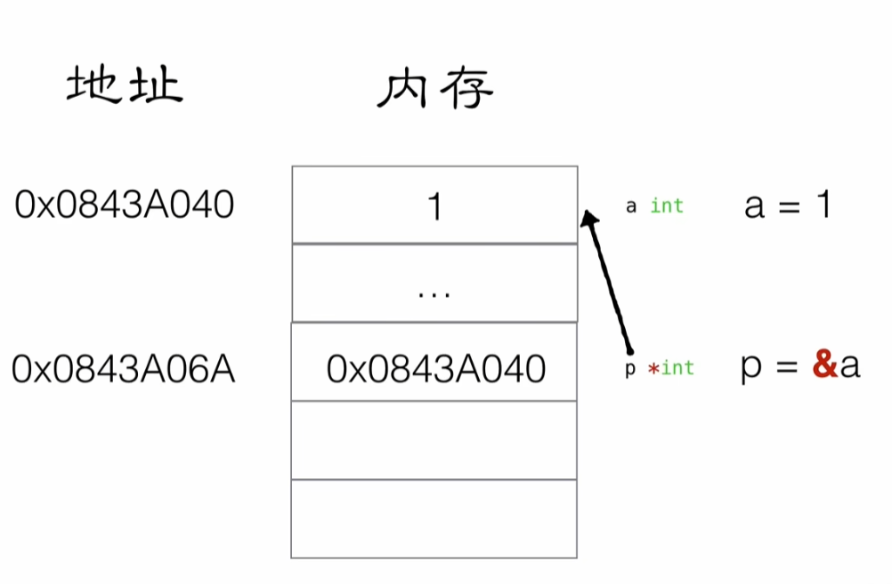

# 指针



```go
package main
import "fmt"

// *int 定义 p 的值是 int地址类型
func changeValue(p *int){

  // 取p存到地址指向的值，进行赋值
  *p=10
}
func main(){
  var a int =1
  // &a 传递 a 的地址
  changeValue(&a)
  fmt.Println("a=",a)
}
```

## 数值交换

```go
func swap(pa *int, pb *int) {
	var temp int
	temp = *pa // temp = main里面的a
	*pa = *pb  // main里面的a = main里面的b
	*pb = temp // main里面的b = temp
}


func main() {
	var a int = 10
	var b int = 20

	swap(&a, &b)

	fmt.Println("a = ", a, " b = ", b)
}
```

## 二级指针

```go
func main() {
	var a int = 10

	var p *int

	p = &a

	fmt.Println(&a)
	fmt.Println(p)

	var pp **int //二级指针

	pp = &p

	fmt.Println(&p)
	fmt.Println(pp)
}
```

