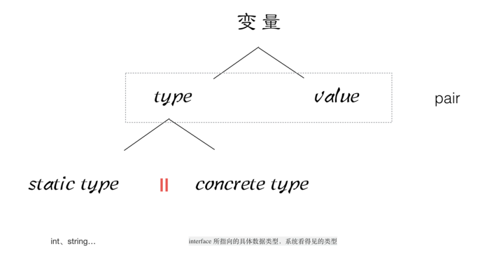

# 反射

## pair



一个变量是有一个反射对，type 表示变量的类型，value 表示变量的值

```go
package main
import "fmt"

func main() {

	var a string
	//pair<statictype:string, value:"aceld">
	a = "aceld"

	//pair<type:string, value:"aceld">
	var allType interface{}
	allType = a

	str, ok := allType.(string)
	fmt.Println(ok, str)
}
```

## 断言

```go
package main

import (
	"fmt"
	"io"
	"os"
)

func main() {
	//tty: pair<type:*os.File, value:"/dev/tty"文件描述符>
	tty, err := os.OpenFile("/dev/tty", os.O_RDWR, 0)

	if err != nil {
		fmt.Println("open file error", err)
		return
	}

	//r: pair<type:  , value:>
	var r io.Reader
	//r: pair<type:*os.File, value:"/dev/tty"文件描述符>
	r = tty

	//w: pair<type:  , value:>
	var w io.Writer
	//w: pair<type:*os.File, value:"/dev/tty"文件描述符>
	w = r.(io.Writer)

	// 通过 Writer 接口写入终端（/dev/tty），文字会显示在当前控制台
	w.Write([]byte("HELLO THIS is A TEST!!!\n"))
}
```

- 示例 2

1. Book 实现了 Reader Writer
2. w = r.(Writer) 断言r是 Writer，能成功，是因为 Book 实现了 Writer

```go
package main

import "fmt"

type Reader interface {
	ReadBook()
}

type Writer interface {
	WriteBook()
}

//具体类型
type Book struct {
}

func (this *Book) ReadBook() {
	fmt.Println("Read a Book")
}

func (this *Book) WriteBook() {
	fmt.Println("Write a Book")
}
// -- Book 实现了Reader Writer


func main() {
	//b: pair<type:Book, value:book{}地址>
	b := &Book{}

  // 定义前 type vlue 是空的
	//r: pair<type:, value:>
	var r Reader
  // 赋值时，type 指向具体的类型
	//r: pair<type:Book, value:book{}地址>
	r = b

	r.ReadBook()

	var w Writer
	//r: pair<type:Book, value:book{}地址>
	w = r.(Writer) //此处的断言为什么会成功？ 因为w r 具体的type是一致

	w.WriteBook()
}
```

## reflect

- 基本类型

```go
package main

import (
	"fmt"
	"reflect"
)

func reflectNum(arg interface{}) {
	fmt.Println("type : ", reflect.TypeOf(arg))
	fmt.Println("value : ", reflect.ValueOf(arg))
}

func main() {
	var num float64 = 1.2345

	reflectNum(num)
}
```

- 复杂类型

1. reflect.TypeOf 获取到 type 类型
2. inputType.NumField() 获取 type 类型里有多少个 字段
  - inputType.Field(i) 获取 字段 的名称
  - inputValue.Field(i).Interface() 获取 字段 的值
3. inputType.NumMethod() 获取有多少个方法
  - inputType.Method(i) 取的具体的方法

```go
package main

import (
	"fmt"
	"reflect"
)

type User struct {
	Id   int
	Name string
	Age  int
}

func (this User) Call() {
	fmt.Println("user is called ..")
	fmt.Printf("%v\n", this)
}

func main() {
	user := User{1, "Aceld", 18}

	DoFiledAndMethod(user)
}

func DoFiledAndMethod(input interface{}) {
	//获取input的type
	inputType := reflect.TypeOf(input)
	fmt.Println("inputType is :", inputType) // main.User
	fmt.Println("inputType Name is :", inputType.Name()) // User

	//获取input的value
	inputValue := reflect.ValueOf(input)
	fmt.Println("inputValue is:", inputValue) // {1 Aceld 18}
	fmt.Println("inputValue Interface is:", inputValue.Interface()) // {1 Aceld 18}

	//通过type 获取里面的字段
	//1. 获取interface的reflect.Type，通过Type得到NumField ,进行遍历
	//2. 得到每个field，数据类型
	//3. 通过filed有一个Interface()方法等到 对应的value

	for i := 0; i < inputType.NumField(); i++ {
		field := inputType.Field(i) // Id, Name, Age
		value := inputValue.Field(i).Interface() // 1, Aceld, 18

		fmt.Printf("%s: %v = %v\n", field.Name, field.Type, value) 
		// Id: int = 1, Name: string = Aceld, Age: int = 18
	}

	//通过type 获取里面的方法,调用
	for i := 0; i < inputType.NumMethod(); i++ {
		m := inputType.Method(i)
		fmt.Printf("%s: %v\n", m.Name, m.Type)
	}
}
```


